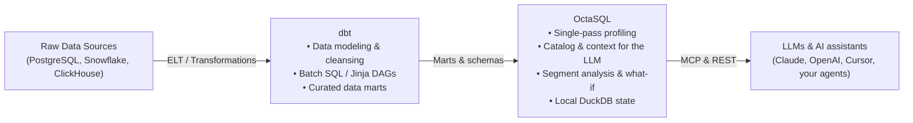

<div align="center">

# 🌌 OctaSQL
### Text-to-SQL for local LLMs: validated, read-only, on-premise

[](https://martystev.github.io/octasql-landing/)
[](https://martystev.github.io/octasql-landing/)
[](https://martystev.github.io/octasql-landing/)
[](https://martystev.github.io/octasql-landing/)

<p align="center">
  <b>Your local LLM writes the SQL. OctaSQL gives it only the schema it needs, validates the SQL and runs it read-only.</b><br>
  7 DBMS for SQL + DuckDB/Parquet • Segment contribution analysis • AST validation • MCP server
</p>

[**🌐 Open the website →**](https://martystev.github.io/octasql-landing/)

---

</div>

## 🚀 About OctaSQL

**OctaSQL** makes LLM analytics over enterprise data warehouses checkable: the SQL is validated on an AST and runs read-only, and metric changes are broken down by segment with exact contributions.

**Built for local models.** OctaSQL is made for teams that run their own open-weight model (vLLM, Ollama) next to the data, in a closed perimeter. It sits between that model and the warehouse; cloud models (Claude, GPT, Cursor) connect over the same MCP. Over MCP your model calls `get_context` to receive only the part of the schema the question needs, writes the SQL, and calls `run_sql`: OctaSQL validates it, runs it read-only and returns hints the model can act on (a filter value no row holds, together with the values the column does hold). For these two tools OctaSQL needs no LLM key of its own. The same model answers correctly about 30 percentage points more often than it does alone, and on a 75-table schema its prompt is 13 times shorter.

**Why local models gain the most:**
- **Context window.** On a 75-table schema the model reads ≈2.5K characters of context instead of ≈33K (−92%), so a small model fits a large schema, with no loss in accuracy.
- **Hardware and speed.** About five times fewer tokens per question (≈9K instead of ≈50K in the agent test) and answers about twice as fast (median 6.3 s instead of 13.0 s), so the same GPU serves several times more questions.
- **Model via API.** When the same open-weight model is paid per token, the bill shrinks with the tokens.

**Agent test, local model.** The same open-weight model (≈35B, MoE, on vLLM) answered 16 questions on a 75-table schema as a tool-calling agent, twice. With only a read-only SQL tool it got 10 and 11 right and spent ≈819K and ≈781K tokens; through OctaSQL it got 13 and 12 right and spent ≈162K and ≈129K tokens, with the median answer at 6.3 s instead of 13.0 s. Large cloud models need OctaSQL less: on the same questions Claude got 15 right either way.

OctaSQL can also call an LLM itself (`query`, `deduce`):
- **The LLM** writes SQL or a typed plan from the retrieved context, and proposes hypotheses for a metric change.
- **The OctaSQL core** validates the SQL, resolves entities through the catalog and its relationships, compiles planned-mode SQL from the typed plan, and decomposes metric changes into the exact contribution of each segment from aggregates.

---

## 📊 Comparison: Plain Text-to-SQL and OctaSQL

| Question type | Plain Text-to-SQL (LangChain and similar) | OctaSQL |
| :--- | :--- | :--- |
| **🔍 Diagnostic analysis**<br>*(“Why did revenue drop by 14% in Q3?”)* | ❌ **No built-in decomposition.** Returns the number; breaking the change down by segment is left to the user. | ✅ **Segment contribution analysis.** Decomposes the change into the exact contribution of each segment and flags segments that moved against the total. |
| **🔗 Multi-table joins** | ⚠️ **Join errors.** Can join on look-alike column names and multiply rows. | ✅ **Catalog relationships.** Retrieval follows foreign keys, declared or inferred and checked on the data; planned mode joins only along them. |
| **📈 What-if scenarios**<br>*(“What would revenue be if this segment had stayed at its baseline?”)* | ❌ **No built-in simulation.** Queries history as it is. | ✅ **Simulation.** Changes one segment (fixed value, multiplier or baseline replacement) in an isolated sandbox; all other segments stay as observed. |
| **⚡ Tokens and context**<br>*(LLM input cost)* | ❌ **Often the whole schema in every prompt.** On large schemas this means long prompts and “lost in the middle” errors. | ✅ **92% smaller prompt on a 75-table schema (≈33K → ≈2.5K characters, OctaSQL 0.4.4).** The context layer passes only the relevant part of the schema. |
| **🛡 Security and data integrity**<br>*(Prompt injections, DROP/UPDATE)* | ⚠️ **Risk of data changes.** A prompt injection can lead to a destructive statement. | ✅ **AST validation + read-only execution.** Modifying statements are rejected before they reach the database; queries run in a read-only transaction on PostgreSQL, Greenplum, MySQL and ClickHouse. On MS SQL, Snowflake and BigQuery use a read-only role. |
| **🔒 Privacy and compliance**<br>*(GDPR, HIPAA, banking secrecy)* | ❌ **Data goes to an external API.** Schemas and sample rows are sent to a cloud model. | ✅ **On-premise, air-gapped.** Runs inside your perimeter; with a local LLM no schema, sample values or rows leave it. |

**Measured results, OctaSQL 0.4.4.** One general open-weights LLM, served locally, answers each question three ways: alone with the bare schema; as an MCP client of OctaSQL (`get_context` + `run_sql`, at most two corrections); and through OctaSQL's own pipeline. A query is correct when it returns the same rows as a reference query. Each question is run twice; accuracy is averaged across databases.

| Question set | Model alone | Your model + OctaSQL | OctaSQL own pipeline | Prompt, characters (alone → with OctaSQL) |
| :--- | :--- | :--- | :--- | :--- |
| 33 public databases, 298 questions | 43.5% | **73.8%** | 73.5% | ≈1.2K → ≈2.8K (schema + notes) |
| 18 more public databases, 500 questions (held-out run) | 38.5% | — | **71.5%** | ≈1.3K → ≈4.0K (own pipeline) |
| Enterprise schema, 75 tables, questions in Russian | 56.9% | 91.7% | **94.4%** | ≈32.9K → ≈2.5K (-92%) |

*Through OctaSQL the same model gains about 30 percentage points (+30.3 on the 33 databases, interval +20.1 to +40.5; +33.1 for the own pipeline on the 18 held-out databases, run once after all settings were fixed). Most errors of the model alone are columns that do not exist. On small schemas the whole schema fits and OctaSQL sends more, not less, because it adds notes and values. Results will differ on your schema, questions and model. Prompt sizes are in characters, not tokens.*

```
                      ┌─────────────────────────────────────────┐
                      │          User Business Query            │
                      │  "Why did revenue in Siberia drop 14%?" │
                      └────────────────────┬────────────────────┘
                                           │
                                           ▼
┌────────────────────────────────────────────────────────────────────────────────────────┐
│                                   OCTASQL CORE                                         │
│                                                                                        │
│  [ 1. BM25 Catalog Search ] ──► [ 2. DuckDB State ] ──► [ 3. Hypotheses (LLM) ]         │
│      (Schema + Synonyms)          (Pre-aggregated)          (Segment candidates)       │
│                                                                          │             │
│                                                                          ▼             │
│  [ 6. Segment Attribution ] ◄── [ 5. Run in Your DBMS ] ◄── [ 4. AST Validation ]      │
│      (Delta Decomposition)        (Read-only execution)        (Allowlisted SQL)       │
└──────────────────────────────────────────┬─────────────────────────────────────────────┘
                                           │
                                           ▼
                      ┌─────────────────────────────────────────┐
                      │         Segment Contribution Report     │
                      │  • Logistics: -68.4% (-$2.34M)          │
                      │  • Discount:  -21.1% (-$0.72M)          │
                      └─────────────────────────────────────────┘
```

*Illustrative example: the figures above are sample data, not output of a live run.*

---

## 🔄 Relationship to dbt

A frequent question: **"We already have dbt — why do we need OctaSQL?"** They work on different layers and fit together:



| Dimension | **dbt** | **OctaSQL** |
| :--- | :--- | :--- |
| **Purpose** | **Transformation (T in ELT):** cleans and organizes raw warehouse data into curated tables. | **Answering questions over that data:** gives an LLM the relevant schema, validates and runs its SQL, and explains metric changes by segment. |
| **Primary user** | Analytics and data engineers writing SQL/YAML. | AI assistants and agents, analysts, decision makers. |
| **Execution model** | Scheduled batch runs that build tables and views. | Interactive queries, compact schema context, and pre-aggregated state in local DuckDB. |
| **Analysis** | Static metric definitions (MetricFlow / Semantic Layer). | **Segment contribution analysis:** hypotheses, drill-down by segment, segments that moved against the total, what-if simulation. |
| **AI integration** | Not built in. | **MCP server**, REST API, and `planned` mode (SQL compiled from a typed plan, not written by the LLM). |

> **If you already use dbt,** OctaSQL scans the marts dbt builds like any other tables, and the descriptions you keep there make its context better.

---

## ⚡ Key Capabilities

| Feature | Description |
| :--- | :--- |
| **🛡 AST-validated, read-only SQL** | An AST validator (SELECT, WITH and set operations; allowlisted functions and tables) rejects modifying statements; queries run in a read-only transaction where the DBMS offers one (PostgreSQL, Greenplum, MySQL, ClickHouse). |
| **📊 Segment contribution analysis** | Exact decomposition of a metric change into the contribution of each segment of a materialized dimension (region, category, channel), with an "(other)" residual so contributions add up to the total change. |
| **🗄 7 DBMS for SQL + DuckDB/Parquet** | SQL runs on PostgreSQL, Greenplum, ClickHouse, MySQL/MariaDB, MS SQL Server, Google BigQuery and Snowflake (Snowflake not yet tested on a live account); DuckDB/Parquet for scan and analysis. One DBMS per deployment. |
| **⚡ Local DuckDB state** | Pre-aggregated metric state in a local DuckDB file, so drill-downs and what-if run without re-scanning the warehouse. |
| **🔌 Model Context Protocol (MCP)** | JSON-RPC 2.0 server over stdio or Streamable HTTP (`/mcp`) for **Claude Desktop**, **Claude Code**, **Cursor** and your own agents. |
| **🔒 Air-gapped** | Runs on-premise without internet access with any OpenAI-compatible local endpoint (vLLM, Ollama, LM Studio). With a local model, your data stays inside the perimeter. |
| **🔑 Signed licenses** | Offline Ed25519 signature verification; a license can be locked to a node fingerprint (machine-id and MAC). |

---

## 🖥 Supported DBMS

```
SQL execution
┌──────────────┬──────────────┬──────────────┬──────────────┐
│  PostgreSQL  │  Greenplum   │  ClickHouse  │ MySQL/Maria  │
├──────────────┼──────────────┼──────────────┼──────────────┤
│    MS SQL    │   BigQuery   │  Snowflake   │              │
└──────────────┴──────────────┴──────────────┴──────────────┘
Scan and analysis: DuckDB / Parquet
```

---

## 🔌 Integration over MCP

Tools: `get_context`, `run_sql`, `query`, `observe_metric`, `drilldown_metric`, `observe_graph`, `simulate_what_if`, `deduce`, `get_catalog_snapshot`, `list_states`. With your own model, `get_context` and `run_sql` are enough; `query` and `deduce` let OctaSQL call its configured LLM itself.

**Claude Desktop** (stdio, server in Docker), `claude_desktop_config.json`:

```json
{
  "mcpServers": {
    "octasql": {
      "command": "docker",
      "args": ["exec", "-i", "semantic-engine-api", "octasql", "mcp"]
    }
  }
}
```

**Claude Code, Cursor and other HTTP clients** (Streamable HTTP at `/mcp`):

```bash
claude mcp add --transport http octasql http://127.0.0.1:8000/mcp \
  --header "Authorization: Bearer $OCTASQL_API_KEY"
```

```json
{"mcpServers": {"octasql": {"url": "http://127.0.0.1:8000/mcp",
  "headers": {"Authorization": "Bearer <OCTASQL_API_KEY>"}}}}
```

---

## 📄 Licensing and Roadmap

**OctaSQL** is distributed under a commercial on-premise license, verified offline and optionally locked to a node.

- 🗺️ **[Roadmap](https://github.com/MartyStev/octasql-landing/blob/main/docs/FUTURE_FEATURES_ROADMAP.md)**: several databases in one instance (next release), personal data masking and tokenization, AST-level access policies, an audit log for SIEM, and more.

To request a license key or discuss a pilot:
👉 **[Contact us on the website →](https://martystev.github.io/octasql-landing/)**

<div align="center">
  <sub>© 2026 OctaSQL. All rights reserved.</sub>
</div>
